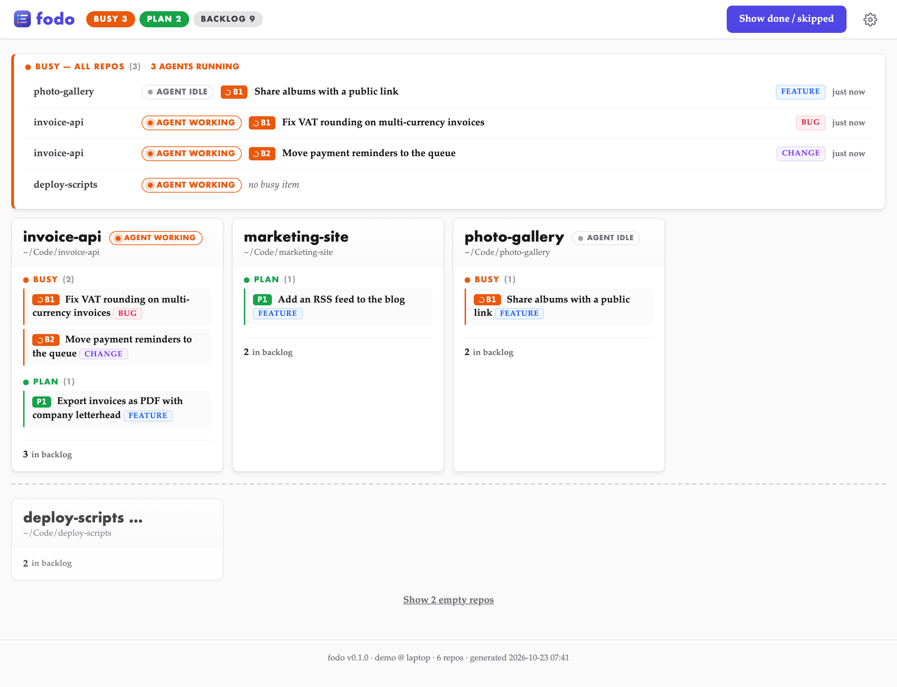

# claude-plugins

Peter Forret's Claude Code plugins. Add the marketplace **`pforret-claude`** once, then install the
plugins you want from it.

```text
/plugin marketplace add pforret/claude-plugins
```

To get new versions, run `/plugin marketplace update pforret-claude`, or turn on auto-update for the
marketplace in `/plugin`.

## Plugin: FODO

Per-repo todo workflow in `docs/todo/`: add items, plan them into PRPs, implement, verify and archive
them, with a local dashboard across all your repos.

FODO stands for *Fear Of Dozing Off*. The name was chosen to be quick to type: on a QWERTY keyboard,
`f-o-d-o` alternates hands (left, right, left, right) with very little finger travel.



### Install

```text
/plugin install fodo@pforret-claude
```

### Use

Run these inside a git repo. The first command creates `docs/todo/` if it isn't there yet.

```text
/fodo:add fix the login redirect after password reset    # Claude classifies, sizes and plans it
/fodo:list                                               # planned items 1, 2, … plus plan (P1…) and busy (B1…)
/fodo:plan 1                                             # research + clarifying questions → PRP, item becomes P1
/fodo:start P1                                           # implement it, item becomes B1
/fodo:done                                               # verify the acceptance criteria and archive it
/fodo:skip 2                                             # drop an item, with a reason
/fodo:web                                                # open the dashboard of all your repos
```

Small items can skip planning: `/fodo:start 1`. Items are plain markdown files, so the todo list is
readable on GitHub too. The [fodo README](plugins/fodo/README.md) covers every command, the
dashboard (PHP 8.1+), and what the plugin reads and writes.

## License

MIT. Working on the plugins themselves: see [DEVELOP.md](DEVELOP.md).
